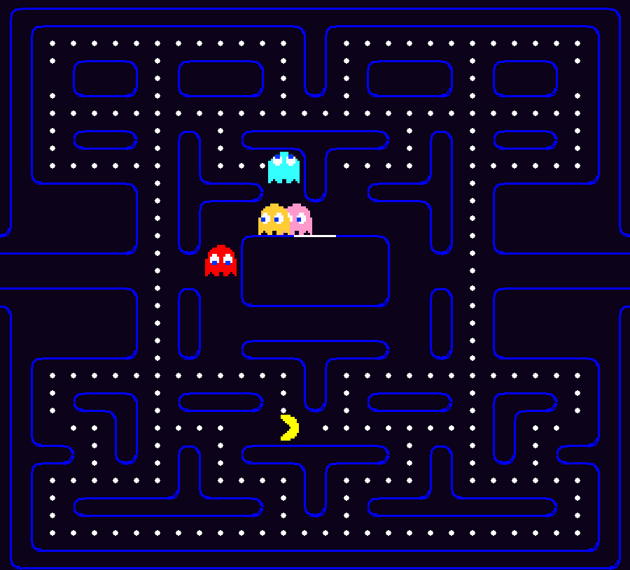
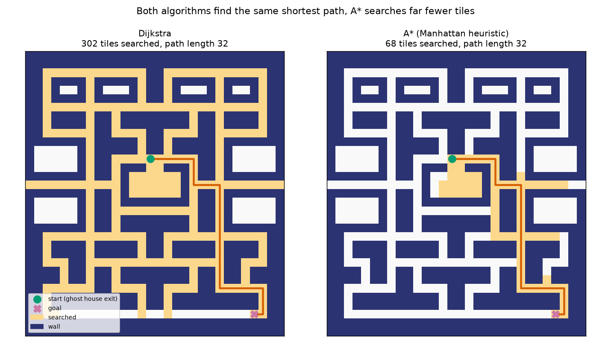
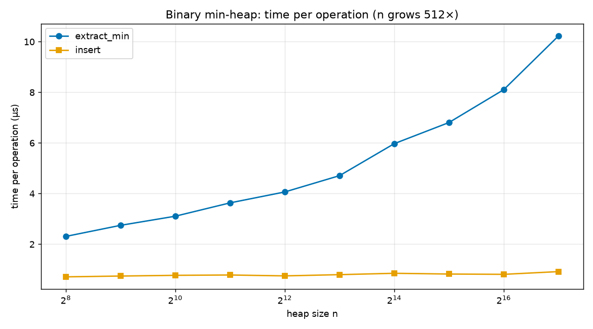
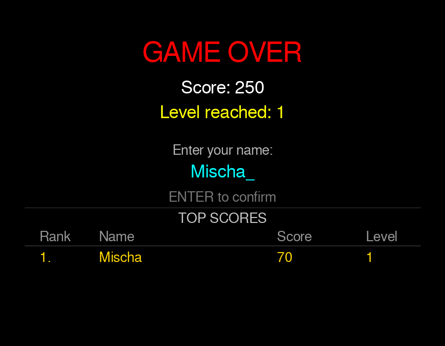

# Pacman Search Optimization

A Pacman game in Python where the ghosts find their way through the maze with **shortest-path search**. The data structure behind it, a **binary min-heap priority queue**, and the search algorithms, **Dijkstra** and **A\***, are implemented from scratch. The project measures how much faster A* is and adds levels and a high-score table to the game.

<p>
  
  
  
  
</p>

<p align="center">
  
</p>

## What I built

The game itself (maze, sprites, sound, ghost personalities) comes from an existing open-source Pacman, see [Credits](#credits). These parts are my work:

| Part | What it does | Where |
|---|---|---|
| **Priority queue** | A binary min-heap written without `heapq`: `insert`, `extract_min`, `peek_min` and `decrease_priority`. | [`model/algorithms/priority_queue.py`](model/algorithms/priority_queue.py) |
| **Pathfinding** | Dijkstra's algorithm and A* with a Manhattan-distance heuristic on the maze grid. A setting switches between them. | [`model/algorithms/pathfinding.py`](model/algorithms/pathfinding.py) |
| **Ghost navigation** | Ghosts follow the computed shortest path to their target. A cached path is only recalculated when a ghost reaches a new tile or its target moves. | [`model/entity/ghost/ghost.py`](model/entity/ghost/ghost.py) |
| **Levels** | Clearing the maze starts the next level with faster ghosts. | [`draw/game_engine.py`](draw/game_engine.py) |
| **High scores** | A game-over screen with name entry and a persistent top-10 table. | [`draw/game_engine.py`](draw/game_engine.py), `scores.json` |
| **Tests and benchmarks** | 33 unit tests and two scripts that produce the figures below. | [`tests/`](tests), [`benchmarks/`](benchmarks) |

## How the ghosts find Pac-Man

Each ghost has a target tile, for example Pac-Man's position for Blinky. Instead of just stepping to the neighbouring tile that is closest in a straight line, which gets ghosts stuck behind walls, a ghost searches the maze for the shortest walkable path and follows it.

- **Dijkstra** expands tiles in order of their distance from the start, so it searches in all directions.
- **A\*** adds a guess of the remaining distance (Manhattan distance to the goal) to each tile's priority, so it searches mainly towards the goal. It still returns a shortest path.
- Both pull the next tile from the priority queue, so the speed of the heap matters directly.

<p align="center">
  
</p>

Averaged over 300 random start and goal tiles on the real maze (392 walkable tiles), reproduced with [`benchmarks/search_comparison.py`](benchmarks/search_comparison.py):

| Algorithm | Tiles searched | Time per search |
|---|---|---|
| Dijkstra | 158.7 | 846 µs |
| A* | 43.9 | 248 µs |

A* searches about 3.6 times fewer tiles and is about 3.4 times faster, and both return the same path length on every one of the 300 pairs.

**Performance.** A ghost does not search on every frame. It keeps its path and only searches again when it enters a new tile, when its target has moved to another tile, or when the path is used up. While frightened, eaten or inside the ghost house, a ghost keeps the original straight-line movement.

## The priority queue

The heap is stored in a flat list, where the children of index `i` are at `2i + 1` and `2i + 2`. `insert` appends an item and moves it up, `extract_min` replaces the root with the last item and moves it down. Both take O(log n) time.

<p align="center">
  
</p>

When the heap grows 512 times, from 256 to 131,072 items, `extract_min` becomes about 4 times slower and `insert` about 1.3 times, far from the 512 times that linear growth would give. The curve for `extract_min` bends up for the largest heaps, probably because big lists no longer fit into the processor cache. Values depend on the machine, you can reproduce them with [`benchmarks/heap_scaling.py`](benchmarks/heap_scaling.py).

## Game extensions

<p align="center">
  
</p>

- **Levels.** After the last dot, the ghosts turn permanently frightened. When Pac-Man has eaten all four, the maze is refilled and the next level starts. Ghost speed rises by one step per level.
- **Game over and scores.** When the last life is lost, you enter a name of up to 12 characters. The ten best scores are saved in `scores.json` and shown with rank, name, score and level.
- **HUD.** The status line shows score, FPS, level and lives.

## Run it yourself

Tested with Python 3.12 and 3.13.

```bash
pip install -r requirements.txt
python pacman.py
```

Steer with the arrow keys. In `settings.py` you can change the behaviour:

| Setting | Effect |
|---|---|
| `USE_PATHFINDING` | `True`: ghosts follow shortest paths. `False`: original straight-line movement. |
| `PATHFINDING_ALGORITHM` | `"a_star"` or `"dijkstra"`. |
| `DEBUG` | Shows the ghosts' targets and the tile grid. |

### Tests and benchmarks

```bash
python -m pytest -k "not plot"        # 31 fast tests, under a second
python -m pytest                      # all 33, the two plot tests take a few minutes
python benchmarks/search_comparison.py
python benchmarks/heap_scaling.py
```

The tests check the heap (ordering, duplicates, interleaved operations, the heap property) and the pathfinding (neighbours, walls, shortest paths, unreachable goals, A* against Dijkstra). The two plot tests open plot windows that you have to close, and they are the slow ones.

## Repository structure

```
.
├── pacman.py                    # Entry point and event loop
├── settings.py                  # Game and pathfinding settings
├── model/
│   ├── algorithms/
│   │   ├── priority_queue.py    # Binary min-heap
│   │   └── pathfinding.py       # Dijkstra, A*, dispatcher
│   └── entity/                  # Player and ghosts
├── draw/game_engine.py          # Game loop, levels, game-over screen, scores
├── levels/                      # Level setup
├── tests/                       # Heap and pathfinding tests
├── benchmarks/                  # Scripts for the figures in this README
├── docs/                        # Images used in this README
├── assets/, media/              # Sprites and sounds
└── requirements.txt
```

## Limitations

- All tiles cost 1 to walk, so the search finds the path with the fewest tiles. Tunnel wrap-around is not used by the search.
- `decrease_priority` looks for the item with a linear scan, so it takes O(n) time. The searches do not use it, they insert duplicate entries instead.
- The ghosts all use the same search and differ only in their target.

## Credits

The Pacman game, its sprites and its sounds were written by Vadim Martsun ([MathMark/PacMan](https://github.com/MathMark/PacMan)) and later adapted for teaching by Merve Selçuk-Şimşek. Pac-Man is a trademark of Bandai Namco, this is a non-commercial learning project.
